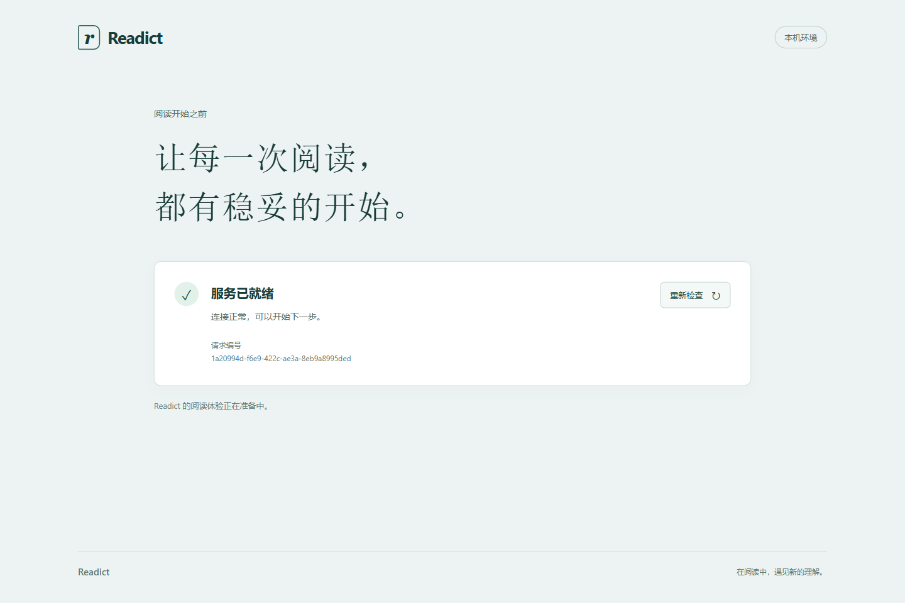
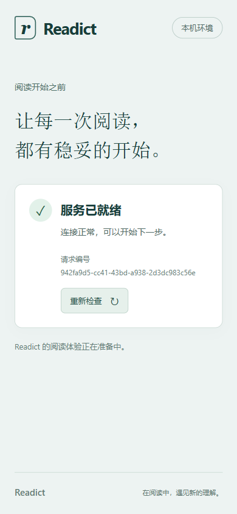

# M00 本机实施与验收记录

日期：2026-11-19（Asia/Shanghai）。范围：M00-01～M00-05。状态：已完成本机阶段验收。

本记录只描述本次正式应用工程的实际执行结果，不改变设计仓库历史文档的状态，不代表 M01 或生产部署完成。按用户最新要求，M00 全部源码、配置示例、工具和本记录统一提交一次，不按内部小步骤拆分提交、不自动推送。

## 基线和实际依赖

- 工程：`readict-app`；执行前只有初始化提交 `57dfce4`，工作区干净。
- 关联代码：本记录与 M00 实现位于同一个 Git 提交。提交后用 `git log -1 --format=fuller -- docs/m00-verification.md` 获取准确提交号；不在文件内部填写尚未生成的提交哈希。
- 设计输入：平级设计仓库的 M00 执行文档 0.1、系统设计 0.3、模块计划 0.2 和 ADR-0002。
- 系统：Windows 11 amd64；JDK 21.0.10，JAVA_HOME 与 Maven 使用同一 JDK；Maven 3.9.14；Node 24.14.0；npm 11.9.0；准备脚本使用 Python 3.10.8。
- MySQL 客户端和真实服务端均为 8.0.44，MySQL80 运行，端口 3306。服务器原有默认排序规则为 utf8mb4_0900_ai_ci，没有修改；两个新库使用 utf8mb4_0900_bin。
- 实际 Maven 依赖树：Spring Boot 4.1.2、MP Boot 4 Starter／MP 3.5.18、MyBatis 3.5.19、MyBatis-Spring 4.1.0、HikariCP 7.0.2、Flyway Core／MySQL 12.4.0、Connector/J 9.7.0。无普通 MyBatis Starter 或 Boot 3 Starter。
- 前端锁定：React／React DOM 19.3.1、Vite 8.3.8、TypeScript 7.0.2、React Vite 插件 6.1.2、@types/node 24.19.2、@types/react／@types/react-dom 19.3.0、oxlint 1.94.0、tsx 4.23.15。
- 原型锁文件的 React Vite 插件实际为 6.3.0；本工程遵循 M00 文档的 6.1.2，未静默升级。

## 实际执行和结果

| 检查 | 实际命令／方式 | 结果 |
|---|---|---|
| 工具与端口 | Java／Maven／Node／npm／mysql 版本、服务和监听检查 | 版本一致；初始 8080／5173 空闲 |
| 数据库准备 | `python scripts/prepare_database.py` | 新建两个库与四个独立账号；权限和跨库拒绝验证通过 |
| Maven 依赖 | `mvn dependency:tree`，限定 MP／MyBatis／Flyway／驱动／连接池 | 解析成功，版本见上表，无重复 Starter |
| effective POM | `mvn help:effective-pom '-Doutput=target/effective-pom.xml'` | 成功，产物在忽略的 target 中 |
| 普通后端单测 | `mvn test`，首次未加载数据库凭据 | 3 个测试类，9 项通过，0 失败／错误／跳过 |
| 完整后端构建与 IT | 加载 test 后 `mvn -Pmysql-it verify` | 9 项单测 + 8 项真实 MySQL／HTTP IT 全部通过，0 失败／错误／跳过，生成可执行 jar |
| 锁文件重装与前端检查 | `npm ci`、`npm run lint`、`npm test`、`npm run build` | 全部成功；前端 9 项测试通过，0 失败／取消／跳过；安装审计 0 漏洞 |
| 启动失败检查 | `python scripts/verify_startup.py` | 缺少凭据、缺少 profile、错误迁移密码、8080 冲突、5173 冲突均拒绝启动 |
| 开发启动 | 加载 dev 后 `mvn spring-boot:run '-Dspring-boot.run.profiles=dev'` | 8080 回环监听，状态和健康检查正常，无默认 Security 密码 |
| 打包运行与重启 | 加载 dev 后 `java -jar target/readict-backend-0.0.1-SNAPSHOT.jar --spring.profiles.active=dev` | 重复启动正常，Flyway 无新增变更，真实代理状态为 UP |
| 停止 | 开发终端 Ctrl+C | Maven 启动进程输出 graceful shutdown complete；最终本任务启动的 8080／5173 已停止，未停止 MySQL |
| 正式 jar 内容 | 检查 jar 中 mapper 和 migration 资源 | 正式 XML／V1 均存在；无 TypeProbe、FoundationIT 或测试配置 |

后端报告：`backend/target/surefire-reports/`、`backend/target/failsafe-reports/`。最终完整日志：`.artifacts/backend-verify.log`。启动负向日志：`.artifacts/startup-*.log`。这些机器产物被 Git 忽略；本受控记录保留统计、方法、结果和必要限制。

## T01～T13 验收矩阵

| 编号 | 实际证据 | 结论 |
|---|---|---|
| T01 工程与依赖 | effective POM、实际依赖树、后端 verify、前端 ci／build／lint／test；正式 jar 资源检查 | 通过 |
| T02 账号隔离 | 四账号分别 SELECT DATABASE()／CURRENT_USER()／VERSION()、SHOW GRANTS；连接另一库均 Access denied。运行账号只有 DML，迁移权限仅限对应 schema | 通过 |
| T03 首次／重复迁移 | 空 readict_test 实际执行 V1；后续上下文重启和 flyway.migrate() 均无新迁移，history 和 checksum 不变，基线一条 | 通过 |
| T04 Mapper／XML | 真库 BaseMapper insert／selectById／updateById／deleteById 与 XML 查询，字段和 UTC 毫秒值一致；精确清理本次 key | 通过 |
| T05 版本更新 | 两个并发线程以相同 expectedVersion 更新，仅一个返回 1，另一个返回 0；旧版本重放返回 0，最终版本只增加一次 | 通过 |
| T06 真实事务 | 独立 Spring 事务代理 Bean 先 BaseMapper insert 再 XML update；正常提交可见，主动异常后独立非事务查询无记录；测试方法无 @Transactional | 通过 |
| T07 UUID／时间 | UUID 编码与 SQL HEX 对照；真 SQL 往返和 null；非法字节长度；三个 JDBC 读取路径；自动 ResultMap 处理器；上海／纽约默认时区下 UTC 毫秒时间一致 | 通过 |
| T08 测试误连 | TestDatabaseInitializer 在 refresh 前检查；dev URL、缺少／冲突 profile、root、Flyway URL 等负向配置被拒；连接／迁移探针均为 0 | 通过 |
| T09 状态与故障 | 真实 MySQL 正常路径 HTTP 200；受控 Repository 故障与连接 SQLException 返回 503 Problem Details；无内部 SQL 或异常原文 | 通过 |
| T10 启动失败 | 缺少凭据／profile、无效迁移密码均非零退出，无 Started 标记；端口冲突也退出；无 Mock 回退 | 通过 |
| T11 安全与日志 | 非允许路径 401 Problem Details；POST 无 CSRF 为 403；无 UserDetailsService／默认密码；合法请求 ID 透传、非法 ID 替换、MDC 清理；日志未包含生成密码、拒绝的头值或 JDBC URL | 通过 |
| T12 真实代理与客户端 | 8080 直连和 5173 代理均 UP；前端测试 200／503／HTML／坏 JSON／网络／取消／竞态；浏览器后端未启动时显示不可用，启动后手动重试恢复就绪 | 通过 |
| T13 存活／就绪 | 正常时均 200 UP；受控 DataSource 连接异常时状态和 readiness 为 503，liveness 为 200；未停止共享 MySQL80 | 通过 |

最终数据库只读复核：

| 数据库 | Flyway 版本 | checksum | 基线 | 本次 it_ 残留 |
|---|---|---|---|---|
| readict_dev | 1，success=1 | -1107340707 | application=readict，version=0，一条 | 0 |
| readict_test | 1，success=1 | -1107340707 | application=readict，version=0，一条 | 0 |

开发库的首次 V1 在端口占用负向检查中执行：该场景可能先迁移后绑定 Web 端口。随后正常启动与 jar 重启均校验通过；未通过删除数据库重做首次迁移。

## 浏览器证据

真实 Chromium 页面检查：桌面 1440×960、手机宽度 390×844。状态、请求编号和重试按钮可见，两个宽度均无横向溢出；手动重试会发出真实代理请求。

后端未启动时的浏览器网络错误属于实际不可用场景，页面正确显示不可用；恢复后重试显示就绪。未将这一预期错误描述为正常请求零错误。

## 实施中发现的问题与修正

1. Spring 的 ProblemDetail.forStatusAndDetail 需要 HttpStatusCode，首次编译使用 int 失败；改为显式 HttpStatusCode.valueOf，后续构建和响应测试通过。
2. 首次真实库上下文中 V1 成功，但 Tomcat 的 JDK WEPoll 内部 AF_UNIX 回环连接失败：Unable to establish loopback connection／Invalid argument。未关闭安全、未更换 JDK；独立 Selector 探针在显式项目临时目录下成功。环境脚本设置 `jdk.net.unixdomain.tmpdir` 后，真实 Tomcat、Java HttpClient、集成测试、开发启动及重启均通过。JDK 对此属性的定义见 [Oracle 网络属性说明](https://docs.oracle.com/en/java/javase/21/docs/api/java.base/java/net/doc-files/net-properties.html)。本记录仅确认显式目录修正有效，不将默认 TEMP 失败的底层原因外推为已定位的 JDK 缺陷。
3. PowerShell 下未加引号的 `-Doutput=target/effective-pom.xml` 被错误拆分为额外阶段；改为单引号包住整个参数后成功，README 已采用正确命令。
4. Flyway 默认 INFO 会打印 JDBC URL 查询参数；将 FlywayExecutor 日志设为 WARN 后，最终完整测试日志和启动负向日志检查不再出现 JDBC URL。MyBatis 参数日志默认禁用。
5. Maven 初次解析镜像的插件元数据曾报告缺少 checksum 的警告，依赖解析最终成功。Mockito 在 JDK 21 上提示动态附加 agent 将在未来受限；当前 17 项后端测试全部实际执行通过。未将这些警告描述为测试失败或已解决的未来兼容性问题。

## 交付限制与后续入口

- 本轮证明本机环境可运行；没有生产部署、完整安全审计、全浏览器兼容或性能承诺。
- 故障分支通过受控替身／连接异常验证，正常持久化和事务路径连接真实 readict_test；没有实际停止 MySQL 服务或撤销其他账号权限。
- M00 没有 UUID 业务表；已验证类型处理器、映射元数据和真实只读 SQL。M01 创建首张 UUID 业务表后需补充 BaseMapper 写入／读回验证。
- Flyway 只创建元信息和历史表。M01 再引入用户、Session JDBC、认证和 CSRF token 等能力；本模块没有业务写接口。
- 四个随机密码只在本机受限 `.local/database.json` 中，root 凭据未保存；源码、截图和受控报告不包含真实秘密。
- 设计仓库已有未提交改动保持原状。任务完成后只在应用仓库统一中文提交，不推送。
